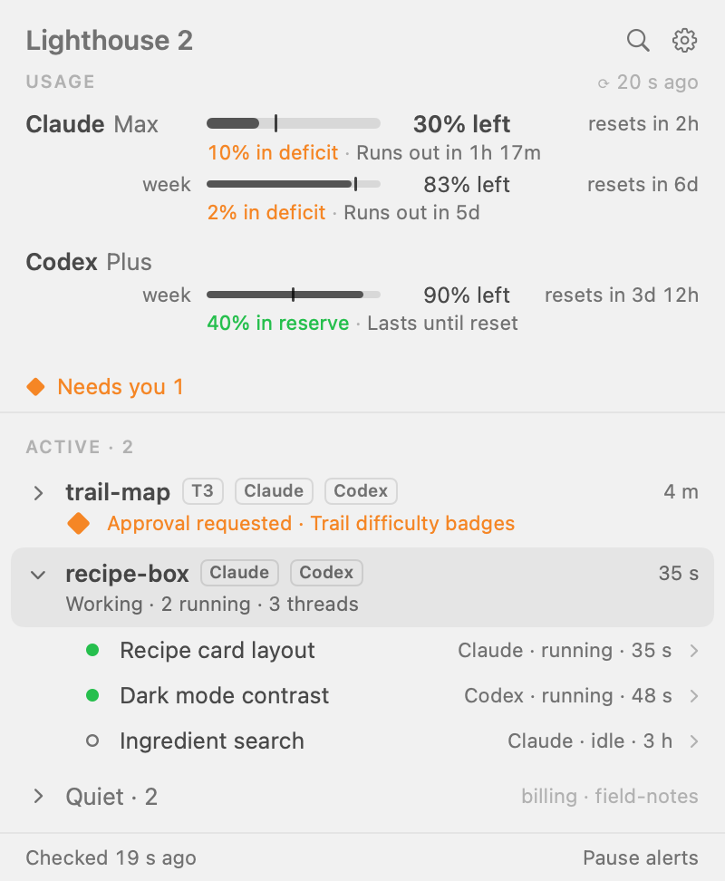
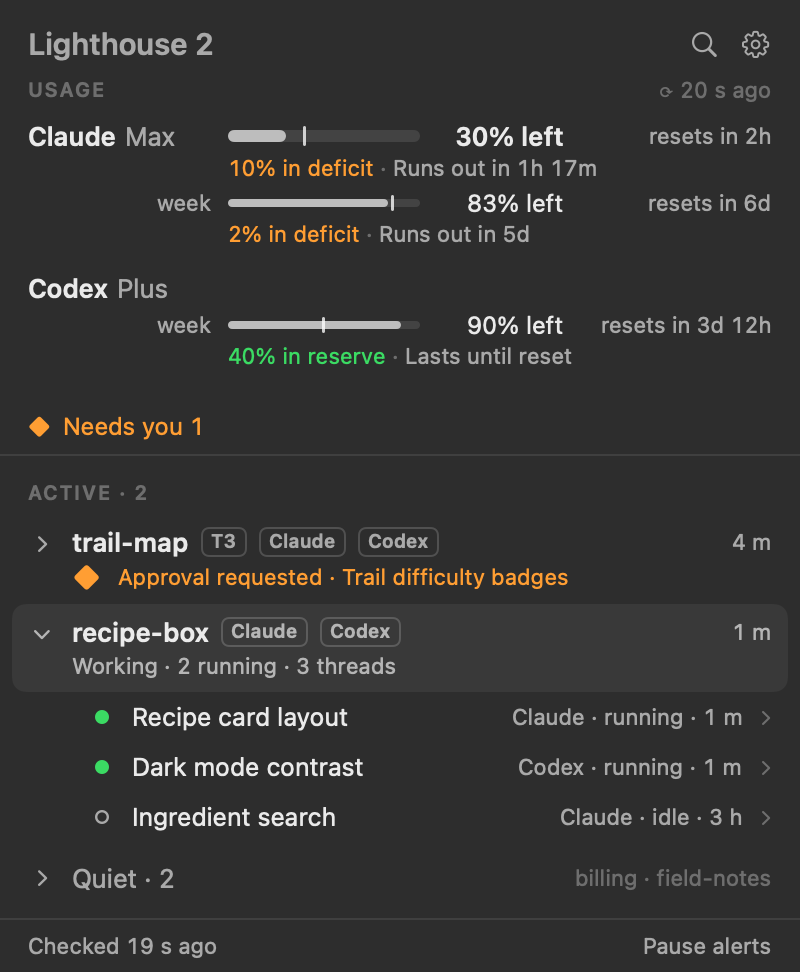
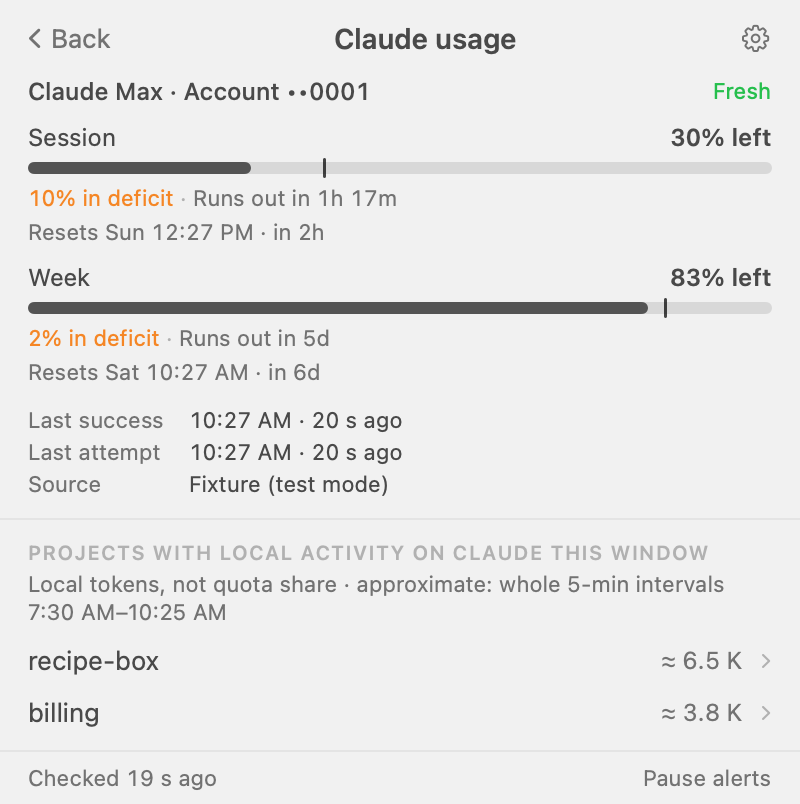
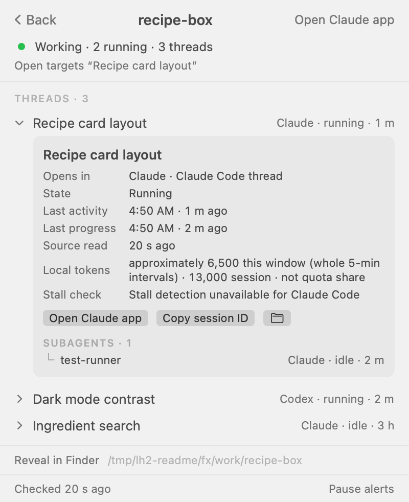
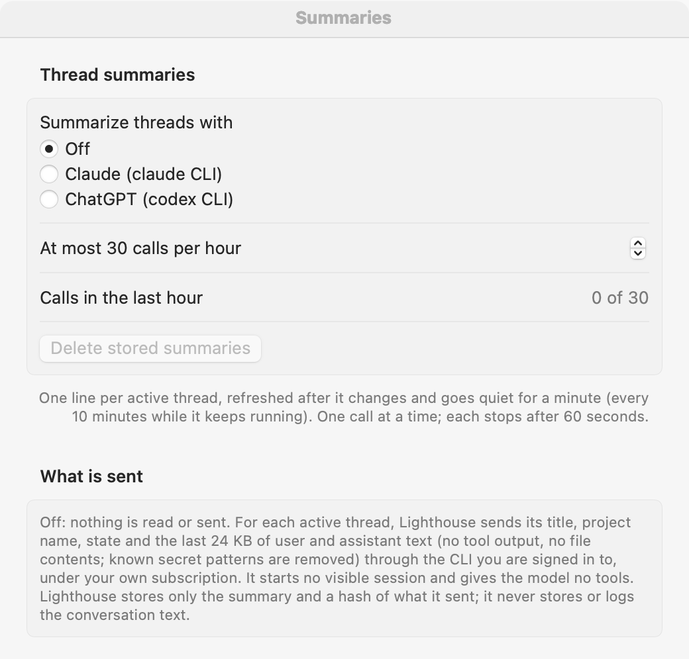

# Lighthouse 2

Version 0.0.12 · macOS 14 or later · Apple silicon · [MIT License](LICENSE)

Lighthouse 2 is a menu bar app for people who run coding agents in Claude Code, Codex and T3 Code. Click the lighthouse in the menu bar, or press ⌃⌥Space, and one panel shows:

- how much of your Claude and Codex limits is left, and whether your current pace runs out before the window resets,
- which agent is waiting for your approval, has gone quiet, or has stalled,
- your projects, each opening to its threads and their subagents,
- an Open button that takes you to the thread in the app that owns it: T3 Code, the ChatGPT (Codex) app, or the Claude app.

It only watches. It never starts, stops, resumes, messages or approves an agent, and it never stores message text.

<p>
  
  
</p>

All pictures use made-up projects from the app's test mode.

## Install

### From the command line

```sh
curl -fsSL https://raw.githubusercontent.com/dpreil-ydlp/lighthouse-2/main/install.sh | sh
```

The script downloads `Lighthouse-2-0.0.12.zip` from this repository's v0.0.12 release over HTTPS, checks it against the SHA-256 published with the release, installs `/Applications/Lighthouse 2.app` and opens it. Read [install.sh](install.sh) first if you like; it is short. If `/Applications/Lighthouse 2.app` already exists and is not Lighthouse 2, the script stops and changes nothing. If an older build sits at `/Applications/Lighthouse.app`, the script quits it and moves it to the Trash, so only one copy remains.

Files downloaded with `curl` carry no quarantine flag, so macOS opens the app without the Gatekeeper warning described below.

### Download the app

1. Download `Lighthouse-2-0.0.12.zip` from the [v0.0.12 release](https://github.com/dpreil-ydlp/lighthouse-2/releases/tag/v0.0.12).
2. Optional: download `Lighthouse-2-0.0.12.zip.sha256` too and run `shasum -a 256 -c Lighthouse-2-0.0.12.zip.sha256` in the same folder.
3. Double-click the zip and drag `Lighthouse 2.app` to Applications.
4. Open it. The first time, macOS blocks it, because the app is signed ad-hoc and not notarized by Apple (there is no paid Developer ID behind this release). You see "“Lighthouse 2” Not Opened" with **Move to Trash** and **Done**. Click **Done**.
5. Open System Settings › Privacy & Security, scroll to Security, and click **Open Anyway** next to the line about Lighthouse 2. macOS may ask for your password. It remembers the choice.

If you prefer Terminal for step 5: `xattr -dr com.apple.quarantine "/Applications/Lighthouse 2.app"`, then open the app again.

## First run

The panel opens with a short welcome. It lists the sources it found and offers three switches, all off: notifications, open at login, and thread summaries. Click **Done** to see your projects.

- ⌃⌥Space opens and closes the panel. You can pick another shortcut in Settings › General.
- ⌘, opens Settings. ⌘Q quits while the panel or Settings is in front. There is no Dock icon.
- Usage bars stay off until you turn them on in Settings › Usage, one switch per provider.
- **Keychain.** Claude usage needs Claude Code's sign-in token, the Keychain item “Claude Code-credentials”. Lighthouse 2 reads it through Apple's `/usr/bin/security`, the same tool Claude Code uses for that item, so normally macOS shows no prompt, and updates do not bring one back. If macOS does ask (an item made some other way), it asks for `security`; choose **Always Allow** once.
- Codex usage reads `~/.codex/auth.json`, a plain file, so there is no prompt.

## What you see

**Usage with pace.** Each bar shows how much of a window is left. The tick marks where you would be at an even pace. Orange "in deficit" means you are using it faster than that and shows when you would run out; green "in reserve" means you are ahead. A provider page lists the projects with local activity in that window and their approximate local token counts.



**Projects, threads and subagents.** Active projects sit at the top, quiet ones fold away. A project opens to its threads; a thread opens to its state, last activity, local token count and subagents, with the button that opens it in its own app.



**Settings.** Panes for General, Sources, Usage, Open-in, Notifications, Summaries and Projects. Summaries are off until you pick a provider.



## Privacy

Lighthouse 2 reads these files in place and never writes to them:

| Source | Path |
|---|---|
| Claude Code sessions | `~/.claude/projects/**/*.jsonl` |
| Claude account id, for usage | `~/.claude.json` |
| Codex sessions and titles | `~/.codex/sessions/**/*.jsonl`, `~/.codex/session_index.jsonl` |
| Codex sign-in, for usage | `~/.codex/auth.json` |
| T3 Code | `~/.t3/userdata/statev2.sqlite` (opened read-only), `~/.t3/userdata/environment-id` |
| Project folders | `.git` metadata of the folders your sessions ran in |

From session files it keeps metadata only: paths, IDs, titles, times, token counters and states. It does not store or log message text, prompts, tool output or approval text, and it does not copy the T3 or Codex databases. Symbolic links inside the session folders are not followed.

It writes only its own files:

- `~/Library/Application Support/Lighthouse/lighthouse.sqlite`: the metadata above, your pins and settings, and, with summaries on, each summary line and a hash of the request that made it,
- `~/Library/Caches/com.lighthouse.v2/summary-scratch`: an empty folder the summary command runs in (summaries on only),
- `~/Library/Preferences/com.lighthouse.v2.plist`: the Settings window position.

**Network.** With usage turned on, Lighthouse 2 sends one HTTPS request every 2 minutes per provider, to `api.anthropic.com/api/oauth/usage` (Claude) or `chatgpt.com/backend-api/wham/usage` (Codex), with your existing sign-in token. It keeps tokens in memory only, never refreshes them, and never writes them to its store or log. It opens no listening port. With usage off and summaries off, it sends nothing.

**Thread summaries are opt-in and send text.** If you turn them on in Settings › Summaries, Lighthouse 2 runs the `claude` or `codex` command-line tool you already have, signed in to your own subscription, to write a one-line summary of each active thread. Each request carries the thread's title, project name, state and the last 24 KB of user and assistant text. Tool calls, tool output and file contents are left out, and known secret patterns (API keys, tokens, private keys, `password=…`) are replaced with `[redacted]` before sending. That text goes to Anthropic or OpenAI, whichever you picked. The default models are `claude-haiku-5-5` and `gpt-6-luna`; at most 30 calls per hour by default. Only the summary and a hash of the request are stored. The Codex CLI also sends your global `~/.codex/AGENTS.md`; codex-cli 0.165.0 has no switch to leave it out. Turning summaries Off stops all reading and sending.

## Requirements

- A Mac with Apple silicon. The release is arm64 only.
- macOS 14 or later. This release ran on macOS 26.5 (MacBook Air) and was built and tested on 26.6. Versions 14 to 26.4 have not been tried.
- Claude Code, Codex (CLI or the ChatGPT app) or T3 Code, for something to watch.

## Uninstall

```sh
curl -fsSL https://raw.githubusercontent.com/dpreil-ydlp/lighthouse-2/main/install.sh | sh -s -- --uninstall
```

That quits Lighthouse 2 and moves `/Applications/Lighthouse 2.app` to the Trash. It touches nothing else. By hand:

1. If you turned on "Open Lighthouse at login", turn it off in Settings › General.
2. Quit: open the panel and press ⌘Q.
3. Move `/Applications/Lighthouse 2.app` to the Trash.
4. To delete its data too: `rm -r ~/Library/Application\ Support/Lighthouse ~/Library/Caches/com.lighthouse.v2` and `defaults delete com.lighthouse.v2`.
5. If an older version (0.0.8 or earlier) was allowed Keychain access, open Keychain Access, find “Claude Code-credentials”, and remove Lighthouse 2 from the item's Access Control list. Do not delete the item itself; it is Claude Code's sign-in.

## Build from source

You need Xcode with Swift 6 on Apple silicon.

```sh
git clone https://github.com/dpreil-ydlp/lighthouse-2.git
cd lighthouse-2
swift test            # core and app-logic tests
scripts/package.sh    # Release build: dist/Lighthouse-2-0.0.12.zip and its .sha256
```

`scripts/package.sh` builds with SwiftPM, so it works without opening Xcode. It strips the binary (symbols go to `dist/Lighthouse.app.dSYM`), signs ad-hoc and writes a zip that holds only `Lighthouse 2.app`. Set `SIGN_IDENTITY` to sign with your own certificate. `App/Lighthouse.xcodeproj`, generated from `App/project.yml` with XcodeGen, builds the same app in Xcode.

The app's bundle id is `com.lighthouse.v2`. Settings, permissions and the store are tied to that id, so they carry over from earlier builds.

## Security

See [SECURITY.md](SECURITY.md) to report a problem privately.
