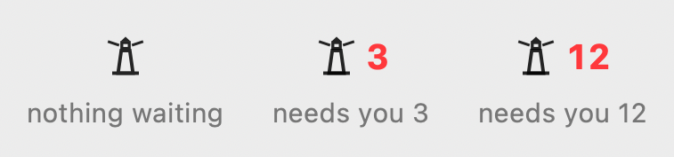

# Lighthouse 2

Version 0.0.16 · macOS 14 or later · Apple silicon · [MIT License](LICENSE)

Lighthouse 2 is a menu bar app for people who run coding agents in Claude Code, Codex and T3 Code. Click the lighthouse in the menu bar, or press ⌃⌥Space, and one panel shows:

- how much of your Claude and Codex limits is left, and whether your current pace runs out before the window resets,
- which thread needs you: one waiting for your approval or input, or one whose last message asks you a question, offers a choice or hands you a task,
- your projects, each opening to its threads and their subagents,
- a button that opens the thread's own app: T3 Code opens the exact thread; the ChatGPT (Codex) app and the Claude app open to their main window, and the thread page has **Copy session ID**.

When something needs you, a red count appears next to the lighthouse in the menu bar.

It watches, and it never stores message text. It never starts, stops or approves an agent. The one thing it can send is off until you turn it on: a short nudge to a T3 Code thread that has stalled (see Nudges below).

<p>
  
  
</p>

All pictures use made-up projects from the app's test mode.

## Install

### From the command line

```sh
curl -fsSL https://raw.githubusercontent.com/dpreil-ydlp/lighthouse-2/main/install.sh | sh
```

The script downloads `Lighthouse-2-0.0.16.zip` from this repository's v0.0.16 release over HTTPS, checks it against the SHA-256 published with the release, installs `/Applications/Lighthouse 2.app` and opens it. Read [install.sh](install.sh) first if you like; it is short. If `/Applications/Lighthouse 2.app` already exists and is not Lighthouse 2, the script stops and changes nothing. If an older build sits at `/Applications/Lighthouse.app`, the script quits it and moves it to the Trash, so only one copy remains.

Files downloaded with `curl` carry no quarantine flag, so macOS opens the app without the Gatekeeper warning described below.

### Download the app

1. Download `Lighthouse-2-0.0.16.zip` from the [v0.0.16 release](https://github.com/dpreil-ydlp/lighthouse-2/releases/tag/v0.0.16).
2. Optional: download `Lighthouse-2-0.0.16.zip.sha256` too and run `shasum -a 256 -c Lighthouse-2-0.0.16.zip.sha256` in the same folder.
3. Double-click the zip and drag `Lighthouse 2.app` to Applications.
4. Open it. The first time, macOS blocks it, because the app is signed ad-hoc and not notarized by Apple (there is no paid Developer ID behind this release). You see "“Lighthouse 2” Not Opened" with **Move to Trash** and **Done**. Click **Done**.
5. Open System Settings › Privacy & Security, scroll to Security, and click **Open Anyway** next to the line about Lighthouse 2. macOS may ask for your password. It remembers the choice.

If you prefer Terminal for step 5: `xattr -dr com.apple.quarantine "/Applications/Lighthouse 2.app"`, then open the app again.

## First run

The panel opens with a short welcome. It lists the sources it found and offers three switches, all off: notifications, open at login, and thread summaries. Click **Done** to see your projects.

- ⌃⌥Space opens and closes the panel. You can pick another shortcut in Settings › General.
- ⌘, opens Settings. ⌘Q quits while the panel or Settings is in front. There is no Dock icon.
- Usage bars stay off until you turn them on in Settings › Usage, one switch per provider.
- **Keychain.** Claude usage needs Claude Code's sign-in token, the Keychain item “Claude Code-credentials”. Lighthouse 2 reads it through Apple's `/usr/bin/security`, the same tool Claude Code uses for that item, so normally macOS shows no prompt, and updates do not bring one back. If macOS does ask (an item made some other way), it asks for `security`; choose **Always Allow** once.
- Codex usage reads `~/.codex/auth.json`, a plain file, so there is no prompt.

## What you see

**Needs you.** A yellow **Needs you** tag marks each project and thread that is waiting on you. A thread counts when it asks for an approval or input, or when its turn has ended on a question, a choice or a task for you. A finished report or an optional offer does not count. Opening a project lists those threads first. Click a thread's tag to open it: T3 Code opens that thread; Claude and Codex open their app. On a project row, the tag opens the thread when only one is waiting, and opens the row when several are. Resolving a counted T3 Code request or resuming a reply hand-off clears that item in about a second. An alert after three failed nudges clears on the fast path when its run ends or the thread is deleted; progress recorded only in session logs waits for the regular full read. New waits show at the next full read, about once a minute. Settling a T3 Code thread clears everything it raised up to that moment; anything it raises afterwards still counts.

In the menu bar, the lighthouse shows the number of threads waiting on you in red, and nothing else.



How a thread is judged depends on thread summaries (see Privacy). With summaries on, the summary model also answers yes or no to "does this thread need you now?". With summaries off, Lighthouse 2 checks the wording of the thread's last message on your Mac. Either way, a thread you answered last never counts, and a running thread never counts.

**Usage with pace.** The panel shows one line per provider. Click **USAGE** to see each window in full, with its pace and reset time. Each bar shows how much of a window is left. The tick marks where you would be at an even pace. Orange "in deficit" means you are using it faster than that and shows when you would run out; green "in reserve" means you are ahead. A provider page lists the projects with local activity in that window and their approximate local token counts.


**Nudges.** Turn on **Nudge stalled T3 Code threads** in Settings › Sources. When a T3 Code thread has made no progress for 30 minutes, Lighthouse 2 sends it this message: "Lighthouse (nudge 1 of 3): this thread has shown no progress for 30 minutes. Please continue the task. If you are blocked or need something from me, say what you need." It sends up to 3 nudges, 15 minutes apart. If the thread is still stuck 15 minutes after the third, it shows as **Needs you** ("Still stuck after 3 nudges") and counts in the menu bar. The count lasts 24 hours from the first nudge, or until the thread has sat not running for 10 minutes.

Only T3 Code parent threads are nudged, because T3 can take a message for one exact thread. Subagents, Claude Code threads and Codex app threads are never messaged; they keep showing as gone quiet. Turning nudges on connects Lighthouse 2 to T3 Code on your Mac (see Privacy).

**Projects, threads and subagents.** Active projects sit at the top, then the ones completed recently (24 hours by default). Quiet projects stay hidden unless you turn them on in Settings › General. Point at a project row to get a one-line button, such as **T3 Code ↗**, that opens the app of the thread named on the row. A project opens to its threads; a thread opens to its state, last activity, local token count and subagents, with the button that opens it in its own app.


**Updates.** From 0.0.14, Lighthouse 2 updates itself. When a newer release is out, an **Update** button appears at the top of the panel. Point at it to see what changes in every release between your copy and the newest. Click it to update: Lighthouse 2 downloads the new zip from this repository's releases, checks its SHA-256 against the published `.sha256`, checks that the app inside is Lighthouse 2 at that version, then quits, replaces itself and opens again. If any step fails, your copy stays as it was. It checks at launch and every 6 hours; Settings › General › Updates has **Check now** and a switch for the automatic checks.

**Settings.** Panes for General, Sources, Usage, Open-in, Notifications, Summaries and Projects. Summaries are off until you pick a provider.


## Privacy

Lighthouse 2 reads these files in place and never writes to them:

| Source | Path |
|---|---|
| Claude Code sessions | `~/.claude/projects/**/*.jsonl` |
| Claude account id, for usage | `~/.claude.json` |
| Codex sessions and titles | `~/.codex/sessions/**/*.jsonl`, `~/.codex/session_index.jsonl` |
| Codex sign-in, for usage | `~/.codex/auth.json` |
| T3 Code | `~/.t3/userdata/statev2.sqlite` (opened read-only), `~/.t3/userdata/environment-id` |
| Project folders | `.git` metadata of the folders your sessions ran in |

From session files it keeps metadata only: paths, IDs, titles, times, token counters, states and a yes/no for "needs you". To decide that yes/no with summaries off, it reads the last message of each finished thread from the last 48 hours on your Mac and checks its wording; nothing is sent. It does not store or log message text, prompts, tool output or approval text, and it does not copy the T3 or Codex databases. Symbolic links inside the session folders are not followed.

It writes only its own files:

- `~/Library/Application Support/Lighthouse/lighthouse.sqlite`: the metadata above, your pins and settings, and, with summaries on, each summary line, its needs-you yes/no and a hash of the request that made it,
- `~/Library/Caches/com.lighthouse.v2/summary-scratch`: an empty folder the summary command runs in (summaries on only),
- `~/Library/Preferences/com.lighthouse.v2.plist`: the Settings window position,
- `~/Library/Application Support/Lighthouse/updates` (only while an update is being installed) and `update.log` next to it: what the last update did,
- `~/Library/Application Support/Lighthouse/t3/token.json` (nudges on only): the T3 Code token, mode 0600 in a folder only you can open.

**Network.** With usage turned on, Lighthouse 2 sends one HTTPS request every 2 minutes per provider, to `api.anthropic.com/api/oauth/usage` (Claude) or `chatgpt.com/backend-api/wham/usage` (Codex), with your existing sign-in token. It keeps tokens in memory only, never refreshes them, and never writes them to its store or log. It opens no listening port.

**Update checks.** At launch, every 6 hours and when you click **Check now**, Lighthouse 2 asks `api.github.com` for this repository's public release list. Only when you click **Update** does it download that release's zip and `.sha256` from `github.com` (GitHub redirects the download to `*.githubusercontent.com`). No token, cookie or identifier is sent. Turn the automatic checks off in Settings › General › Updates. With usage, summaries, nudges and automatic update checks off, it sends nothing.

**Nudges connect to T3 Code, on your Mac only.** Turning nudges on runs T3's own `t3 auth pairing create` for a one-time pairing code, then follows T3's sign-in flow for MCP clients at `http://127.0.0.1:3773` and gets a token with Full access (T3 refuses messages to threads with more access than the token, and new T3 threads start on Full access). Each nudge is one `t3_thread_send` call to that server, carrying only the fixed message above. Nothing else is read or sent through it, and nothing leaves your Mac. T3 issues tokens for about 30 days with no refresh, so Lighthouse 2 gets a new one a few days before it expires. Turning nudges off revokes the T3 session and deletes the token file. Lighthouse 2 stores nudge counts and times per thread, never message text.

**Thread summaries are opt-in and send text.** If you turn them on in Settings › Summaries, Lighthouse 2 runs the `claude` or `codex` command-line tool you already have, signed in to your own subscription, to write a one-line summary of each active thread. Each request carries the thread's title, project name, state and the last 24 KB of user and assistant text. Tool calls, tool output and file contents are left out, and known secret patterns (API keys, tokens, private keys, `password=…`) are replaced with `[redacted]` before sending. That text goes to Anthropic or OpenAI, whichever you picked. The default models are `claude-haiku-5-5` and `gpt-6-luna`; at most 30 calls per hour by default. The same call also answers whether the thread needs you. Only the summary, that yes/no and a hash of the request are stored. The Codex CLI also sends your global `~/.codex/AGENTS.md`; codex-cli 0.165.0 has no switch to leave it out. Turning summaries Off stops all reading and sending.

## Requirements

- A Mac with Apple silicon. The release is arm64 only.
- macOS 14 or later. This release ran on macOS 26.5 (MacBook Air) and was built and tested on 26.6. Versions 14 to 26.4 have not been tried.
- Claude Code, Codex (CLI or the ChatGPT app) or T3 Code, for something to watch.
- For nudges: T3 Code running on the same Mac, with its `t3` command at `~/.t3/bin/t3` (T3 installs it there). Tested with T3 Code 0.1.6: a real stalled thread got its 3 nudges 15 minutes apart, then showed as Needs you.

## Uninstall

```sh
curl -fsSL https://raw.githubusercontent.com/dpreil-ydlp/lighthouse-2/main/install.sh | sh -s -- --uninstall
```

That quits Lighthouse 2 and moves `/Applications/Lighthouse 2.app` to the Trash. It touches nothing else. By hand:

1. If you turned on "Open Lighthouse at login", turn it off in Settings › General. If you turned on nudges, turn them off in Settings › Sources, so the T3 session is revoked.
2. Quit: open the panel and press ⌘Q.
3. Move `/Applications/Lighthouse 2.app` to the Trash.
4. To delete its data too: `rm -r ~/Library/Application\ Support/Lighthouse ~/Library/Caches/com.lighthouse.v2` and `defaults delete com.lighthouse.v2`.
5. If an older version (0.0.8 or earlier) was allowed Keychain access, open Keychain Access, find “Claude Code-credentials”, and remove Lighthouse 2 from the item's Access Control list. Do not delete the item itself; it is Claude Code's sign-in.

## Build from source

You need Xcode with Swift 6 on Apple silicon.

```sh
git clone https://github.com/dpreil-ydlp/lighthouse-2.git
cd lighthouse-2
swift test            # core and app-logic tests
scripts/package.sh    # Release build: dist/Lighthouse-2-0.0.16.zip and its .sha256
```

`scripts/package.sh` builds with SwiftPM, so it works without opening Xcode. It strips the binary (symbols go to `dist/Lighthouse.app.dSYM`), signs ad-hoc and writes a zip that holds only `Lighthouse 2.app`. Set `SIGN_IDENTITY` to sign with your own certificate. `App/Lighthouse.xcodeproj`, generated from `App/project.yml` with XcodeGen, builds the same app in Xcode.

The app's bundle id is `com.lighthouse.v2`. Settings, permissions and the store are tied to that id, so they carry over from earlier builds.

## Changes

See [CHANGELOG.md](CHANGELOG.md). Notes for each release are in [docs/release-notes/](docs/release-notes/).

## Security

See [SECURITY.md](SECURITY.md) to report a problem privately.
